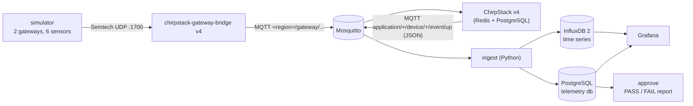

# eng-iot-telemetry-pipeline

A reproducible IoT data bench that starts with one `docker compose up`. It follows a sensor reading
from the radio to a report: simulated LoRaWAN sensors, a gateway, a network server, MQTT, an
ingestion service, two databases, a Grafana dashboard and a device approval report (PASS or FAIL
per device).

Everything is simulated and built on public standards only: LoRaWAN 1.0.3, the Semtech UDP packet
forwarder protocol and Cayenne LPP. All credentials and keys are fixed, obviously fake, local
development values.



## Quickstart

Requirements: Docker with Compose v2, and `curl`. Python is only needed for the unit tests.

```bash
docker compose up -d --build --wait          # start the bench
docker compose run --rm provision            # gateway, application, profile, the ABP devices
docker compose run --rm simulator            # send the deterministic scenario
docker compose run --rm approve              # PASS / FAIL per device
```

Or run everything above plus the automatic checks in one go: `scripts/e2e.sh` (the same script CI
runs). Then open:

| What | URL | Login |
| --- | --- | --- |
| Grafana, dashboard "Telemetry overview" | http://localhost:3000 | admin / admin |
| ChirpStack UI | http://localhost:8080 | admin / admin |
| InfluxDB UI | http://localhost:8086 | admin / local-dev-password (token `local-dev-token`) |

Expected approval report for the scenario, with the end to end thresholds
(`THRESHOLDS=config/thresholds.e2e.toml`, which `scripts/e2e.sh` uses):

```
dev-battery FAIL  battery drop 330 mV above 200 mV
dev-gap    FAIL  fcnt gaps: 1 jump(s), 3 frame(s) missing (allowed 0)
dev-ok     PASS
dev-otaa   PASS
dev-quiet  FAIL  time gaps: 1 interval(s) above 5 s (longest 17 s)
dev-weak   FAIL  rssi median -119.0 dBm below -105 dBm; rssi minimum -120 dBm below -110 dBm
```

With the default `config/thresholds.toml` (`max_interval_s = 900`) `dev-quiet` passes: its 8 s silence is
only a gap under the shortened limit of the end to end file.

Stop and delete all data with `docker compose down -v`.

## Components

| Component | What it does |
| --- | --- |
| `simulator/` | Two fake gateways: builds LoRaWAN uplinks for 6 fake sensors and sends them as Semtech UDP `PUSH_DATA`. Sends `PULL_DATA` keep-alives, answers the bridge's `PULL_RESP` downlinks with `TX_ACK`, and runs the OTAA join of `dev-otaa`. |
| `chirpstack-gateway-bridge` | Converts the Semtech UDP packet forwarder protocol to MQTT. |
| `mosquitto` | MQTT broker between the bridge, ChirpStack and the ingest service. |
| `chirpstack` | LoRaWAN network server: checks the MIC, decrypts the payload, publishes JSON events. |
| `redis`, `postgres` | ChirpStack state. PostgreSQL also hosts the `telemetry` database. |
| `provision/` | Idempotent gRPC script: gateway, application, device profile, the ABP devices. It pages its list calls and leaves a device alone when its ABP activation already matches (so frame counters are not reset). |
| `ingest/` | Subscribes to the up events (QoS 1, persistent session, manual ack) and writes InfluxDB and the PostgreSQL tables. A worker thread retries with backoff, then parks the raw message in `failed_uplinks`. `python -m ingest.replay` reprocesses the parked rows. |
| `gateway-tap` | Same image as `ingest`, its own entrypoint. Subscribes to `<region>/gateway/+/event/up` (radio side), counts frames per gateway from the topic alone (no payload decoding) and writes `gateway_frames` to InfluxDB every 2 s. |
| `influxdb` | Time series store (measurements `uplink` and `gateway_frames`). |
| `grafana/` | Provisioned datasources, the "Telemetry overview" dashboard and the alert rule "Radio OK, database stalled". |
| `approve/` | Runs the SQL in `sql/approval/` and applies `config/thresholds.toml`. |
| `telemetry/` | Pure logic, no network or database, unit tested (see below). |

### Simulated scenario

| Device | Behaviour | Expected verdict |
| --- | --- | --- |
| `dev-ok` | 12 regular uplinks, RSSI around -87 dBm; a second gateway also hears 4 of them (fCnt 0, 3, 6, 9) | PASS |
| `dev-gap` | frame counters 4 to 6 are never sent | FAIL (fcnt gaps) |
| `dev-weak` | RSSI around -119 dBm | FAIL (RSSI) |
| `dev-quiet` | 4 frames, 8 s of silence, 4 more frames | FAIL (time gap, only with `thresholds.e2e.toml`) |
| `dev-battery` | battery falls from 3600 to 3270 mV (330 mV) | FAIL (battery drop) |
| `dev-otaa` | joins over the air (OTAA), 16 uplinks, receives a downlink | PASS |

Gateway EUI, DevEUIs, DevAddrs and session keys are fixed fake test values in
`telemetry/scenario.py`. ChirpStack accepts the frames only if its own MIC check passes, which is
an end-to-end proof of the LoRaWAN implementation.

### Two gateways

A second simulated gateway (`sim-gateway-2`) hears four uplinks of `dev-ok` with another RSSI (10 dB better
for fCnt 0 and 6, 10 dB worse for fCnt 3 and 9). ChirpStack collects the copies for a short deduplication
window and publishes one event whose `rxInfo` has two entries. `ingest` stores one row: the RSSI, SNR and
`gateway_id` of the best reception (highest RSSI), and `gateway_count` = the number of `rxInfo` entries.
`scripts/e2e.sh` checks that there is no duplicated row, that exactly those four rows have
`gateway_count` 2 and that each one carries the expected gateway and RSSI. `gateway-tap` counts the second
gateway's frames too, so the frames at the gateways exceed the rows by those four copies and the join.

### OTAA and downlink (`dev-otaa`)

`dev-otaa` is the only OTAA device (ChirpStack device profile `sim-otaa-lorawan-1.0.3`, the others are
ABP). The simulator sends a JoinRequest (MIC with the AppKey), receives the JoinAccept in a `PULL_RESP`
from the bridge, answers `TX_ACK`, decrypts and validates it, derives NwkSKey and AppSKey (LoRaWAN 1.0.3)
and sends 16 uplinks with them. The DevNonce changes on every run (seconds since the epoch), because
ChirpStack refuses a repeated one.

For LoRaWAN 1.0.x the AppKey goes in the `nwk_key` field of ChirpStack's `DeviceKeys` (documented in the
`DeviceKeys` message of `api/proto/api/device.proto`; the join working proves it). A Class A downlink is
sent after an uplink, so `scripts/e2e.sh` runs the simulator in the background, waits for the log line
`joined dev-otaa`, queues the downlink with `python -m provision.enqueue` (gRPC `Enqueue`) and then
checks that the simulator decrypted the payload `bench-downlink` on FPort 10.

### Payload: Cayenne LPP

Temperature on channel 1 (type 0x67, 0.1 degC), humidity on channel 2 (type 0x68, 0.5 %RH) and
battery voltage on channel 3. Cayenne LPP has no battery type, so the battery is sent as an Analog
Input (type 0x02, 0.01 resolution) in volts: 3300 mV is the value 3.30. The resolution of the
battery field is therefore 10 mV.

### Database

One PostgreSQL instance, two databases: `chirpstack` (with the `pg_trgm` extension ChirpStack
requires) and `telemetry`. The schema is `sql/schema.sql`, loaded on the first start: tables
`devices` and `uplinks` (`dev_eui`, `received_at`, `f_cnt`, `rssi`, `snr`, `temperature_c`,
`humidity_pct`, `battery_mv`, `gateway_id`, `gateway_count`) and `failed_uplinks` (dead letters: raw `payload`, `error`,
`attempts`, `replayed_at`). `ingest` also applies `sql/schema.sql` at start, so an old volume gets new tables.

### Lossless ingestion

1. ChirpStack publishes the events with QoS 1 (`qos=1` in `chirpstack.toml`) and `ingest` subscribes with
   QoS 1 and a fixed client id without clean session, so Mosquitto queues events while `ingest` is down.
2. `on_message` only enqueues. A worker thread stores the event and reports the outcome; the main
   thread, the only one that touches the MQTT client, acknowledges it afterwards (`manual_ack`,
   `flush_acks`). If neither the write nor the parking works, it disconnects and the broker redelivers.
3. Retries with backoff (`INGEST_ATTEMPTS`, `INGEST_BACKOFF_S`) run on the worker, never on the network
   thread. After the last attempt the raw message and the error go to `failed_uplinks` and the message
   is acknowledged.
4. If parking fails too, the message is not acknowledged and the client reconnects, so the broker sends
   it again.

The policy is the pure function `telemetry/delivery.py` (unit tested).

### Alert: radio OK, database stalled

`grafana/provisioning/alerting/rules.yml` evaluates every 10 s (short on purpose, so CI can see it fire and
recover; use minutes in a real deployment): frames counted by `gateway-tap` in InfluxDB in the last 30 s
greater than 0 **and** no new row in PostgreSQL `uplinks` in the last 60 s. The row window is the longer
one on purpose: the tap stamps frames when it flushes (up to 2 s after the frame) and a row carries the
time ingest wrote it, so equal windows could fire falsely at the edge when traffic is sparse. It means the radio side is alive and
the data side is not. No frames at all is not this alert (the rule stays OK). It should also fire for the `gateway-unknown` and
`bad-mic` faults of the fault lab (expected from the rule, not checked by the fault lab): the bridge counts frames that ChirpStack then drops, so frames > 0 and
rows = 0 there too. Read it as "the radio side is alive and nothing reaches the table", then use the
fault lab table to find the layer. Check it with:

```bash
curl -s -u admin:admin http://localhost:3000/api/prometheus/grafana/api/v1/rules
```

Observed while the database refused writes (`ALTER TABLE uplinks ADD CONSTRAINT lab_reject CHECK (false) NOT VALID`):
`inactive` at the start, `firing` about 6 s after the simulator began, `inactive` again once the frames
stopped and left the 30 s window (the same state also needs the previous rows to be older than 60 s, so the fault lab waits for 65 s
without rows before it injects `db-reject`).

## Approval report

```bash
docker compose run --rm approve                  # human readable
docker compose run --rm approve python -m approve.run --json
docker compose run --rm approve python -m approve.run --strict   # exit 1 if any device fails
```

Queries live in `sql/approval/`: frame counter jumps (`LAG` over `f_cnt`), gaps by elapsed time,
RSSI median and minimum, battery minimum and drop. All thresholds are in one place,
`config/thresholds.toml`, with generic bench defaults chosen for this project (for example minimum
RSSI -110 dBm, minimum battery 3000 mV). Tune them for your devices and radio environment.

## Debug by layer

Follow the packet one hop at a time and stop at the first layer where it disappears.

| Layer | What to check | Command |
| --- | --- | --- |
| 1. Packet forwarder (simulator) | Is it sending, and does the bridge acknowledge (`PUSH_ACK`)? | `docker compose run --rm simulator` (logs `sent ...`, and `without PUSH_ACK` count at the end) |
| 2. Gateway bridge | Did the UDP packet arrive and turn into MQTT? | `docker compose logs chirpstack-gateway-bridge` |
| 3. MQTT, gateway topic | Raw uplink as published by the bridge | `docker compose exec mosquitto mosquitto_sub -t '<region>/gateway/+/event/up' -v` |
| 4. ChirpStack | MIC, DevAddr, session, region. Errors such as "gateway does not exist" or "invalid MIC" appear here | `docker compose logs chirpstack` |
| 5. MQTT integration | Decoded event as JSON | `docker compose exec mosquitto mosquitto_sub -t 'application/+/device/+/event/up' -v` |
| 5b. Radio side count | How many frames each gateway handed to the bridge (independent of ingest) | `curl -s -X POST 'http://localhost:8086/api/v2/query?org=local-org' -H 'Authorization: Token local-dev-token' -H 'Content-Type: application/vnd.flux' --data 'from(bucket: "telemetry") \|> range(start: -10m) \|> filter(fn: (r) => r._measurement == "gateway_frames") \|> group(columns: ["gateway_id"]) \|> sum()'` |
| 6. Ingest | Did it store the event? | `docker compose logs ingest` |
| 7. Databases | Rows in PostgreSQL and points in InfluxDB | `docker compose exec postgres psql -U chirpstack -d telemetry -c "SELECT dev_eui, f_cnt, rssi FROM uplinks ORDER BY id DESC LIMIT 5"` |

### Fault lab: symptom, layer, command that proves it

`scripts/fault-lab.sh` injects one failure at a time, taps every hop and goes back to normal. Each row
below is what the lab observed on this bench (5 uplinks of `dev-ok` per fault; CI runs it as the job
`fault-lab`). "gw topic" and "app topic" are message counts from `mosquitto_sub` on
`<region>/gateway/+/event/up` and `application/+/device/+/event/up` (`<region>` is `eu868` by default, see Region).

| Fault (script name) | Symptom | Layer where it stopped | Observed | Command that proves it |
| --- | --- | --- | --- | --- |
| `gateway-unknown`: gateway not registered | no rows, nothing on the app topic | 4. ChirpStack | gw topic 5, app topic 0, rows +0; ChirpStack logs `Getting gateway meta-data failed` | `docker compose logs chirpstack \| grep 'gateway meta-data'` |
| `bad-mic`: wrong device key | same symptom as above | 4. ChirpStack (MIC check) | gw topic 5, app topic 0, rows +0; `None of the device-sessions for dev_addr resulted in valid MIC` | `docker compose logs chirpstack \| grep 'valid MIC'` |
| `broker-down`: Mosquitto stopped | no rows, taps impossible; the simulator still gets every `PUSH_ACK` | 2/3. bridge to broker | rows +0, `mqtt: connection error` and `connect: connection refused` in the bridge log; frames sent meanwhile are never delivered | `docker compose logs chirpstack-gateway-bridge \| grep -E 'connection (error\|refused)'` and `docker compose ps mosquitto` |
| `ingest-down`: ingest stopped | gw and app topics full, rows +0 | 6. ingest | gw topic 5, app topic 5, rows +0 while stopped; after the restart exactly +5 rows (persistent session, no loss, no duplicate), log `session present: True` | `docker compose ps ingest` and the two `mosquitto_sub` taps |
| `db-down`: the telemetry database refuses connections (`ALTER DATABASE telemetry ALLOW_CONNECTIONS false`) | gw and app topics full, rows +0 | 6. ingest to database | ingest log `not acknowledged, reconnecting`; after the database is allowed again exactly +5 rows (the broker redelivers) and `ingest` still running | `docker compose logs ingest` and `docker compose ps ingest` |
| `db-reject`: writes refused (`CHECK (false) NOT VALID` on `uplinks`) | gw and app topics full, rows +0, grafana alert "Radio OK, database stalled" firing | 7. database write | `failed_uplinks` +5, `parked ... in failed_uplinks` in the ingest log; `python -m ingest.replay` stores them and the alert returns to inactive | `docker compose exec postgres psql -U chirpstack -d telemetry -c "SELECT id, error FROM failed_uplinks WHERE replayed_at IS NULL"` |

How to read it: the first tap with fewer messages than the one before it is the hop where data stopped.
Gateway topic full and app topic empty is ChirpStack (bad gateway or bad MIC, told apart by its log);
both full and no rows is ingest or the database (told apart by `docker compose ps ingest` and
`failed_uplinks`).

For InfluxDB:

```bash
curl -s -X POST 'http://localhost:8086/api/v2/query?org=local-org' \
  -H 'Authorization: Token local-dev-token' -H 'Content-Type: application/vnd.flux' \
  --data 'from(bucket: "telemetry") |> range(start: -1h) |> last()'
```

## Region: EU868 and AU915

One variable, `REGION`, selects the region of the whole bench. The default is `eu868`; the other value
is `au915_0` (AU915 sub-band 1). CI runs the end to end job for both (matrix `region`).

```bash
REGION=au915_0 scripts/e2e.sh                       # the full scenario on AU915
REGION=au915_0 docker compose up -d --build --wait  # or by hand: export it for every compose command
```

What `REGION` changes (`docker-compose.yml`, `telemetry/regions.py`):

- the MQTT topic prefix of the gateway bridge and of `gateway-tap` (`au915_0/gateway/<id>/event/up`);
- the region of the device profiles in ChirpStack (`region_config_id`) and their RX2 settings
  (869.525 MHz at DR0 in EU868, 923.3 MHz at DR8 in AU915);
- the uplink frequency and data rate that the simulator puts in every PUSH_DATA (868.1 MHz and 915.2 MHz,
  both SF7BW125).

ChirpStack has both regions enabled (`enabled_regions` in `chirpstack.toml`, files `region_eu868.toml` and
`region_au915_0.toml`): the env variable that would pick one is not applied to that list by ChirpStack
(observed), so the prefix and the device profile choose the region instead. Start from an empty volume
(`docker compose down -v`) when you change `REGION`, because the profiles are created once.

Why `au915_0` and sub-band 1: AU915 has 64 channels of 125 kHz plus 8 of 500 kHz, grouped in 8 sub-bands
of 8 channels plus one 500 kHz channel. A gateway with 8 channels listens to one sub-band. The ChirpStack
region file `region_au915_0.toml` is sub-band 1 (channels 0 to 7 plus 64, 915.2 to 916.6 MHz and
915.9 MHz) and is the AU915 plan that ships with ChirpStack's example configuration. The simulator sends on its
first channel, 915.2 MHz. Use the sub-band of your own gateway in a real deployment (another region file
in `configuration/chirpstack`, another entry in `telemetry/regions.py`). A test checks that the simulator
frequency is a channel of the region file.

## Development

```bash
python -m venv .venv && . .venv/bin/activate    # Windows: .venv\Scripts\activate
pip install -r requirements-dev.txt
ruff check . && ruff format --check . && pytest
```

Pure logic in `telemetry/`, each module testable on a PC:

| Module | Purpose |
| --- | --- |
| `lorawan` | LoRaWAN 1.0.3 data PHYPayload: uplink build and parse, downlink parse (and build, for tests): MHDR, FHDR, FPort, FRMPayload encrypted with AppSKey, MIC (AES-CMAC with NwkSKey) |
| `otaa` | JoinRequest (MIC with the AppKey), JoinAccept decrypt and validate, NwkSKey and AppSKey derivation |
| `semtech_udp` | Semtech UDP `PUSH_DATA` with `rxpk`, `PULL_DATA`, `PUSH_ACK` check, `PULL_RESP` (txpk) parse and `TX_ACK` |
| `lpp` | Cayenne LPP encoder and decoder |
| `chirpstack_event` | Fields of the `uplinks` table from the ChirpStack up event JSON |
| `delivery` | Retry, backoff, park and ack decision of the ingest service |
| `provisioning` | Paging and ABP activation comparison used by `provision/` |
| `rules` | Metrics and thresholds to a verdict with reasons |
| `scenario` | The deterministic simulator scenario |

The LoRaWAN test vectors (uplink data frame, JoinRequest, JoinAccept) come from the public test suite of
[brocaar/lorawan](https://github.com/brocaar/lorawan) (MIT), cited in `tests/test_lorawan.py` and
`tests/test_otaa.py`. No public vector is cited for the session key derivation or for a LoRaWAN 1.0.x
downlink data frame, so those are covered by round trip tests and proven by ChirpStack accepting the
uplinks and the simulator decrypting the downlink in `scripts/e2e.sh`.

CI (`.github/workflows/ci.yml`) has three jobs: `unit` (ruff and pytest) and `e2e` (`scripts/e2e.sh`:
compose up, provisioning, scenario, row checks in PostgreSQL and InfluxDB, the six verdicts, a second
provisioning run that must change nothing, and Grafana) and `fault-lab` (`scripts/fault-lab.sh`, see above).

## Known limitations

This is a bench, not a production pipeline:

- The radio side is best effort: the gateway bridge publishes at QoS 0, so uplinks that arrive while
  Mosquitto is down are lost (the fault lab shows it). Only the data side (ChirpStack to ingest to the
  databases) is lossless.

- Only EU868 and AU915 sub-band 1 are covered by the simulator and by CI. In AU915 the bench does not
  model the 500 kHz channel, the downlink data rates of RX1 or the sub-band of other gateways.
- The best reception is chosen by RSSI alone (ties keep the first). A real deployment may also weigh the SNR.
- `ingest` is at-least-once, not exactly-once: after a reconnect the broker may deliver a message again.
  The duplicate is harmless (ON CONFLICT DO NOTHING) but InfluxDB, keyed by series and timestamp, simply
  overwrites the same point. Mosquitto writes the persistent session to the volume `mosquittodata`
  (`persistence true`, `autosave_interval 30`): events queued for an offline `ingest` survive a clean
  broker restart, but a kill or an out of memory stop of the broker loses up to 30 s of queue (not tested). `docker compose
  down -v` deletes that volume too. A message the worker stores after a reconnect is written but not
  acknowledged, and arrives again as a harmless duplicate.

## License and credits

MIT, see `LICENSE`. The ChirpStack, gateway bridge, Mosquitto, Redis and PostgreSQL configuration is
based on the official [chirpstack/chirpstack-docker](https://github.com/chirpstack/chirpstack-docker)
repository (MIT). ChirpStack is a project of its authors; this repository is not affiliated with it.
