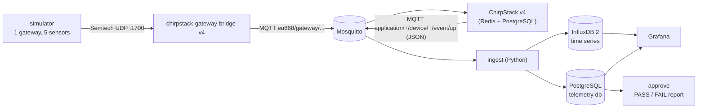

# eng-iot-telemetry-pipeline

A reproducible IoT data bench that starts with one `docker compose up`. It follows a sensor reading
from the radio to a report: simulated LoRaWAN sensors, a gateway, a network server, MQTT, an
ingestion service, two databases, a Grafana dashboard and a device approval report (PASS or FAIL
per device).

Everything is simulated and built on public standards only: LoRaWAN 1.0.3, the Semtech UDP packet
forwarder protocol and Cayenne LPP. All credentials and keys are fixed, obviously fake, local
development values.



## Quickstart

Requirements: Docker with Compose v2, and `curl`. Python is only needed for the unit tests.

```bash
docker compose up -d --build --wait          # start the bench
docker compose run --rm provision            # gateway, application, profile, the ABP devices
docker compose run --rm simulator            # send the deterministic scenario
docker compose run --rm approve              # PASS / FAIL per device
```

Or run everything above plus the automatic checks in one go: `scripts/e2e.sh` (the same script CI
runs). Then open:

| What | URL | Login |
| --- | --- | --- |
| Grafana, dashboard "Telemetry overview" | http://localhost:3000 | admin / admin |
| ChirpStack UI | http://localhost:8080 | admin / admin |
| InfluxDB UI | http://localhost:8086 | admin / local-dev-password (token `local-dev-token`) |

Expected approval report for the scenario, with the end to end thresholds
(`THRESHOLDS=config/thresholds.e2e.toml`, which `scripts/e2e.sh` uses):

```
dev-battery FAIL  battery drop 330 mV above 200 mV
dev-gap    FAIL  fcnt gaps: 1 jump(s), 3 frame(s) missing (allowed 0)
dev-ok     PASS
dev-quiet  FAIL  time gaps: 1 interval(s) above 5 s (longest 17 s)
dev-weak   FAIL  rssi median -119.0 dBm below -105 dBm; rssi minimum -120 dBm below -110 dBm
```

With the default `config/thresholds.toml` (`max_interval_s = 900`) `dev-quiet` passes: its 8 s silence is
only a gap under the shortened limit of the end to end file.

Stop and delete all data with `docker compose down -v`.

## Components

| Component | What it does |
| --- | --- |
| `simulator/` | Fake gateway: builds LoRaWAN uplinks for 5 fake sensors and sends them as Semtech UDP `PUSH_DATA`. |
| `chirpstack-gateway-bridge` | Converts the Semtech UDP packet forwarder protocol to MQTT. |
| `mosquitto` | MQTT broker between the bridge, ChirpStack and the ingest service. |
| `chirpstack` | LoRaWAN network server: checks the MIC, decrypts the payload, publishes JSON events. |
| `redis`, `postgres` | ChirpStack state. PostgreSQL also hosts the `telemetry` database. |
| `provision/` | Idempotent gRPC script: gateway, application, device profile, the ABP devices. It pages its list calls and leaves a device alone when its ABP activation already matches (so frame counters are not reset). |
| `ingest/` | Subscribes to the up events and writes InfluxDB and the PostgreSQL tables. |
| `influxdb` | Time series store (measurement `uplink`). |
| `grafana/` | Provisioned datasources and the "Telemetry overview" dashboard. |
| `approve/` | Runs the SQL in `sql/approval/` and applies `config/thresholds.toml`. |
| `telemetry/` | Pure logic, no network or database, unit tested (see below). |

### Simulated scenario

| Device | Behaviour | Expected verdict |
| --- | --- | --- |
| `dev-ok` | 12 regular uplinks, RSSI around -87 dBm | PASS |
| `dev-gap` | frame counters 4 to 6 are never sent | FAIL (fcnt gaps) |
| `dev-weak` | RSSI around -119 dBm | FAIL (RSSI) |
| `dev-quiet` | 4 frames, 8 s of silence, 4 more frames | FAIL (time gap, only with `thresholds.e2e.toml`) |
| `dev-battery` | battery falls from 3600 to 3270 mV (330 mV) | FAIL (battery drop) |

Gateway EUI, DevEUIs, DevAddrs and session keys are fixed fake test values in
`telemetry/scenario.py`. ChirpStack accepts the frames only if its own MIC check passes, which is
an end-to-end proof of the LoRaWAN implementation.

### Payload: Cayenne LPP

Temperature on channel 1 (type 0x67, 0.1 degC), humidity on channel 2 (type 0x68, 0.5 %RH) and
battery voltage on channel 3. Cayenne LPP has no battery type, so the battery is sent as an Analog
Input (type 0x02, 0.01 resolution) in volts: 3300 mV is the value 3.30. The resolution of the
battery field is therefore 10 mV.

### Database

One PostgreSQL instance, two databases: `chirpstack` (with the `pg_trgm` extension ChirpStack
requires) and `telemetry`. The schema is `sql/schema.sql`, loaded on the first start: tables
`devices` and `uplinks` (`dev_eui`, `received_at`, `f_cnt`, `rssi`, `snr`, `temperature_c`,
`humidity_pct`, `battery_mv`, `gateway_id`).

## Approval report

```bash
docker compose run --rm approve                  # human readable
docker compose run --rm approve python -m approve.run --json
docker compose run --rm approve python -m approve.run --strict   # exit 1 if any device fails
```

Queries live in `sql/approval/`: frame counter jumps (`LAG` over `f_cnt`), gaps by elapsed time,
RSSI median and minimum, battery minimum and drop. All thresholds are in one place,
`config/thresholds.toml`, with generic bench defaults chosen for this project (for example minimum
RSSI -110 dBm, minimum battery 3000 mV). Tune them for your devices and radio environment.

## Debug by layer

Follow the packet one hop at a time and stop at the first layer where it disappears.

| Layer | What to check | Command |
| --- | --- | --- |
| 1. Packet forwarder (simulator) | Is it sending, and does the bridge acknowledge (`PUSH_ACK`)? | `docker compose run --rm simulator` (logs `sent ...`, and `without PUSH_ACK` count at the end) |
| 2. Gateway bridge | Did the UDP packet arrive and turn into MQTT? | `docker compose logs chirpstack-gateway-bridge` |
| 3. MQTT, gateway topic | Raw uplink as published by the bridge | `docker compose exec mosquitto mosquitto_sub -t 'eu868/gateway/+/event/up' -v` |
| 4. ChirpStack | MIC, DevAddr, session, region. Errors such as "gateway does not exist" or "invalid MIC" appear here | `docker compose logs chirpstack` |
| 5. MQTT integration | Decoded event as JSON | `docker compose exec mosquitto mosquitto_sub -t 'application/+/device/+/event/up' -v` |
| 6. Ingest | Did it store the event? | `docker compose logs ingest` |
| 7. Databases | Rows in PostgreSQL and points in InfluxDB | `docker compose exec postgres psql -U chirpstack -d telemetry -c "SELECT dev_eui, f_cnt, rssi FROM uplinks ORDER BY id DESC LIMIT 5"` |

For InfluxDB:

```bash
curl -s -X POST 'http://localhost:8086/api/v2/query?org=local-org' \
  -H 'Authorization: Token local-dev-token' -H 'Content-Type: application/vnd.flux' \
  --data 'from(bucket: "telemetry") |> range(start: -1h) |> last()'
```

## Change the region

The bench uses EU868, the region of the official ChirpStack example. For AU915 (used in Brazil):

1. `configuration/chirpstack/chirpstack.toml`: set `enabled_regions=["au915_0"]`
   (the file `region_au915_0.toml` is already there).
2. `docker-compose.yml`: replace `eu868` by `au915_0` in the three `INTEGRATION__MQTT__*_TOPIC_TEMPLATE`
   variables of `chirpstack-gateway-bridge`, and set `REGION=au915_0` for `provision`.
3. `simulator/run.py` and `telemetry/semtech_udp.py`: the uplink frequency (`freq_mhz`) must be one of
   the region channels, for example 915.2 MHz for AU915 sub-band 1, and the data rate must be valid
   there (`SF7BW125` is valid in AU915).
4. `docker compose down -v` and start again, so ChirpStack provisions the new region.

## Development

```bash
python -m venv .venv && . .venv/bin/activate    # Windows: .venv\Scripts\activate
pip install -r requirements-dev.txt
ruff check . && ruff format --check . && pytest
```

Pure logic in `telemetry/`, each module testable on a PC:

| Module | Purpose |
| --- | --- |
| `lorawan` | LoRaWAN 1.0.3 ABP uplink PHYPayload: MHDR, FHDR, FPort, FRMPayload encrypted with AppSKey, MIC (AES-CMAC with NwkSKey) |
| `semtech_udp` | Semtech UDP `PUSH_DATA` with `rxpk`, `PULL_DATA`, `PUSH_ACK` check |
| `lpp` | Cayenne LPP encoder and decoder |
| `chirpstack_event` | Fields of the `uplinks` table from the ChirpStack up event JSON |
| `rules` | Metrics and thresholds to a verdict with reasons |
| `scenario` | The deterministic simulator scenario |

The LoRaWAN test vector comes from the public test suite of
[brocaar/lorawan](https://github.com/brocaar/lorawan) (MIT), cited in `tests/test_lorawan.py`.

CI (`.github/workflows/ci.yml`) has two jobs: `unit` (ruff and pytest) and `e2e` (`scripts/e2e.sh`:
compose up, provisioning, scenario, row checks in PostgreSQL and InfluxDB, the five verdicts, a second
provisioning run that must change nothing, and Grafana).

## Known limitations

This is a bench, not a production pipeline:

- `ingest` subscribes with QoS 0 and a clean session. If a database write fails three times the
  uplink is dropped, and the retry `sleep` runs on the MQTT network thread.

## License and credits

MIT, see `LICENSE`. The ChirpStack, gateway bridge, Mosquitto, Redis and PostgreSQL configuration is
based on the official [chirpstack/chirpstack-docker](https://github.com/chirpstack/chirpstack-docker)
repository (MIT). ChirpStack is a project of its authors; this repository is not affiliated with it.
